# MyWorld

本地跑一个服务，浏览器打开就是一个工作台 —— 类似 ComfyUI 的那种形态：**前端只负责界面与交互，后端负责内容与任务**，两者通过 REST + WebSocket 通信。

当前是 **v0.1.0 骨架版**：端口管理、静态前端、REST 状态接口、WebSocket 心跳/重连/服务端广播链路都已打通，明暗两套主题可切换，已支持**创建世界**（每个世界是 `data/` 下的一个目录），节点画布留在下一步。

深色：


浅色（右上角 ☀/☾ 切换，或访问 `?theme=light`）：

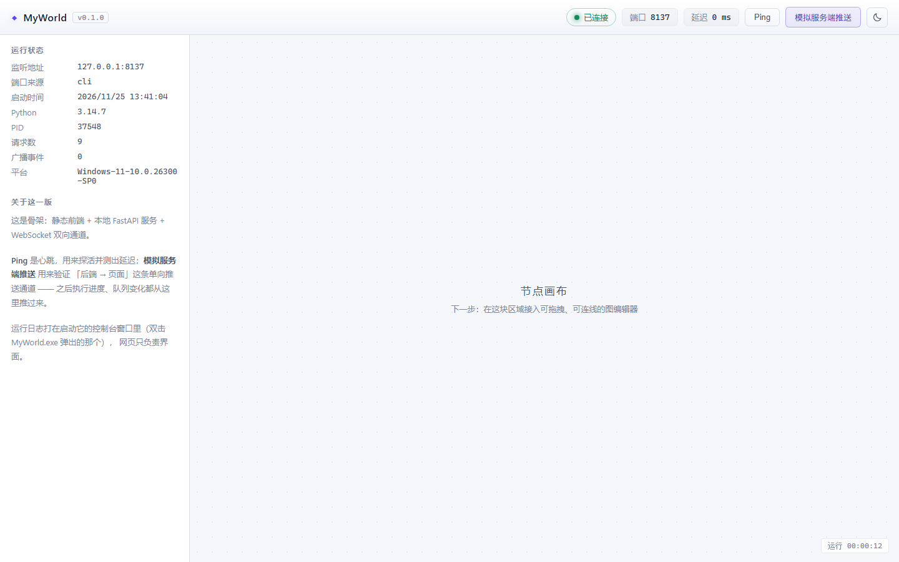

## 快速开始

双击 `MyWorld.exe`，或在命令行里：

```powershell
.\MyWorld.exe                     # 默认 http://127.0.0.1:8000，并自动打开浏览器
.\MyWorld.exe --port 9000         # 换端口
.\MyWorld.exe --no-open           # 只要服务，不弹浏览器
.\MyWorld.exe --print-args        # 只打印最终命令行，排查参数问题
```

双击运行时，服务起来后浏览器会自动跳到工作台；从脚本调用或被重定向（`> log.txt`）时不会自动弹窗口，避免干扰自动化。

首次使用前装依赖（本机已就绪，换机器才需要）：

```powershell
python -m pip install -r requirements.txt
```

## 运行入口是一个原生 exe

`MyWorld.exe` 由 [`tools/launcher.c`](tools/launcher.c) 用 gcc 静态编译，不依赖 PowerShell，也不依赖任何 mingw 运行时 DLL（只用到 Windows 自带的 KERNEL32 与 UCRT）。

它在启动 Python 之前做了这几件事：

| 行为 | 说明 |
|---|---|
| 切工作目录 | 以 exe 所在目录为工作目录，因此可以双击、也可以从任意路径调用 |
| 找解释器 | `MYWORLD_PYTHON` 环境变量 → `.venv\Scripts\python.exe` → PATH 上的 `python` / `python3` / `py -3` |
| 校验项目根 | exe 旁边没有 `myworld\` 时直接给出可读提示，而不是抛一堆 Python 报错 |
| 强制 UTF-8 | 设置 `PYTHONUTF8=1`、`PYTHONIOENCODING=utf-8`，控制台与重定向文件都不会乱码 |
| 透传参数与退出码 | `--port` 等参数原样转发；Python 返回几，exe 就返回几（实测非法端口返回 2） |
| 自动开浏览器 | 挂在交互式控制台上（双击或终端里直接跑）时，服务启动即打开工作台；`--no-open` 可关，重定向场景不会打扰 |
| 日志去向 | 服务端事件、uvicorn 启动信息统一打在这个控制台窗口；网页端只做界面，不放日志面板 |
| Ctrl+C 处理 | 启动器自己忽略 Ctrl+C，交给 uvicorn 优雅关闭，避免留下孤儿进程 |

改了 `launcher.c` 之后重新构建：

```powershell
gcc -O2 -municode -static -static-libgcc -o MyWorld.exe tools\launcher.c
```

> 目前只支持 Windows。C/C++ 的用武之地不止启动器：后续节点执行里的图像处理、音频解码这类计算密集的算子，会以原生模块的形式加进 `native/`，Python 通过扩展模块或进程调用。

## 端口与配置

优先级从高到低：**命令行参数 → 环境变量 `MYWORLD_*` → 配置文件 `myworld.config.json` → 内置默认值**。

| 方式 | 写法 | 说明 |
|---|---|---|
| 命令行 | `.\MyWorld.exe --port 9000` | 最直接 |
| 环境变量 | `$env:MYWORLD_PORT = 9000` | 适合脚本/IDE 里固定 |
| 配置文件 | 复制 `myworld.config.example.json` 为 `myworld.config.json` | 适合长期项目配置 |

字段：`host`（默认 `127.0.0.1`，只允许本机访问）、`port`（默认 `8000`）、`open_browser`、`log_level`、`data_dir`（世界目录，默认 `./data`）。

端口行为：

- 端口被占用时**自动向上找一个空闲端口**，启动 banner 会写明「8000 被占用，已顺延到 8001」，前端「运行状态」里也显示「端口来源」。
- 加 `--strict-port` 则改为直接报错退出，适合需要固定端口的场景。
- 想让局域网其他设备访问，用 `--host 0.0.0.0`（注意：无鉴权，仅限可信网络）。

## 明暗主题

右上角的 ☀/☾ 按钮切换明暗，选择记在 `localStorage`；首次访问跟随系统的 `prefers-color-scheme`，系统主题变了也会跟着变（除非你手动选过）。

- 强制某个主题：`http://127.0.0.1:8000/?theme=light`（截图、演示时方便）
- 两套配色全部收敛在 [`web/css/style.css`](web/css/style.css) 的 CSS 变量里：`:root` 是深色，`:root[data-theme="light"]` 覆盖成浅色。加新组件时用变量，就不会在浅色下出现白底白字。
- 字号也是变量：`--fs-base`（15px）、`--fs-small`、`--fs-tiny`、`--fs-heading`，外加 `--topbar-h`、`--panel-w`；想整体放大只改「排版刻度」那一段，不用逐个组件去调。

## 左侧栏

顶栏最左边的按钮切换展开/收起，快捷键 **`Ctrl+B`**。

- 收起后画布占满整个宽度；宽度与内容位移同时过渡（240ms），整条左栏向左滑出
- 状态记在 `localStorage`，刷新后保持
- 收起时给侧栏加 `inert`，键盘 Tab 不会跑进看不见的区域
- 窗口窄于 900px 时自动隐藏（切换按钮一并隐藏）

## 世界与 data/ 目录

每个「世界」就是 `data/` 下的一个目录，目录名即世界名：

```
data/
  示例世界/
    world.json      # {"name": "...", "created_at": "...", "format": 1}
    thumbnail.png   # 可选：缩略图；没有就用默认图
  第二个世界/
    world.json
```

在左侧功能区点「世界」：每个世界是一张 **16:9 的图片 + 下方名字**，按名字排序；「创建新世界」固定放在所有世界的下面，点它**弹出对话框**输入名字，回车或「创建」即可。新建的世界立刻出现在列表里，点一下选中（暗色蒙版 + 浅色对号）。

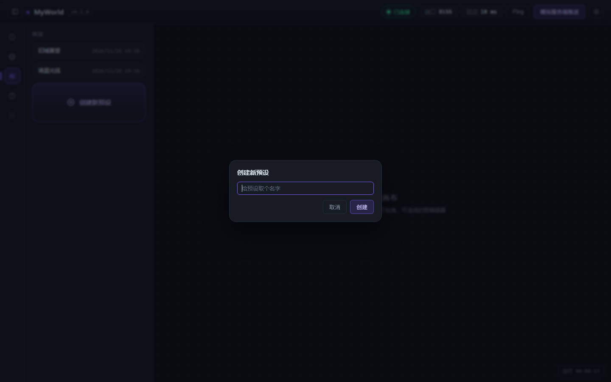

弹窗里可以顺便挑封面：点左边虚线框选一张本地图片，会弹出**裁剪窗口**（拖动平移、**滚轮或滑杆缩放**、九宫格参考），确定后得到 960×540 的封面；也可以不选，之后往世界目录放 `thumbnail.png` 一样有效。

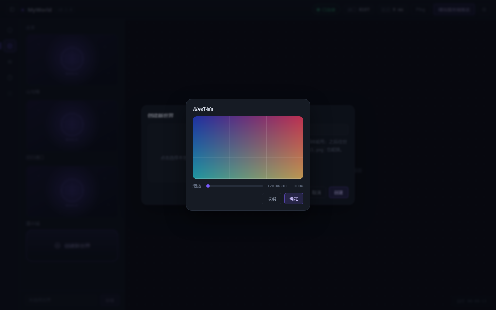

左栏底部固定着一条 **「选中项 + 加载」** 栏（只在「世界」面板出现）：先在列表里点中一张图，底栏会显示它的名字，点「加载」就把这个世界载入 —— 画布切到「当前世界」视图（显示名字与路径），点「关闭世界」回到占位。没有选中时「加载」是灰的。

在任意世界上**右键**会弹出菜单，目前只有「删除」：确认后连同 `data/世界名/` 目录里的所有文件一起删除（不可恢复）；如果删的是当前选中/已加载的世界，底栏和画布会一起复位。

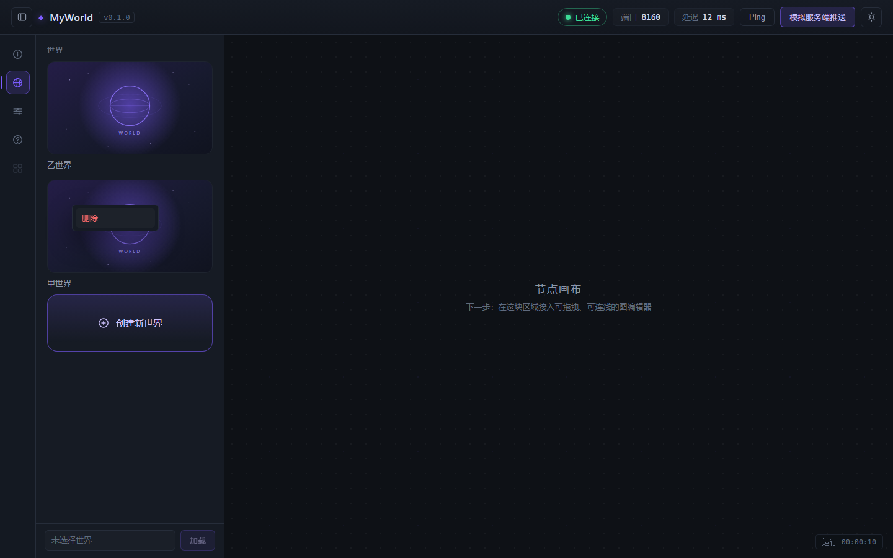

画布区上方还有一条**二级顶栏**（属于画布自己的分栏标签），目前只有「角色」一个标签；具体分栏内容还没做，后续同类分栏会加在这条栏里。

还没有真实图片时，缩略图回落到默认图，**深浅两套**各一张（`web/img/world-default.svg` / `world-default-light.svg`），切换主题时会自动换。想换图就往世界目录里放一张 `thumbnail.png`（也认 `.jpg / .jpeg / .webp / .gif`），刷新即可，不需要重启服务。

图片比例由 `--world-ratio` 变量控制，想用 4:3 就把它改成 `4 / 3`。

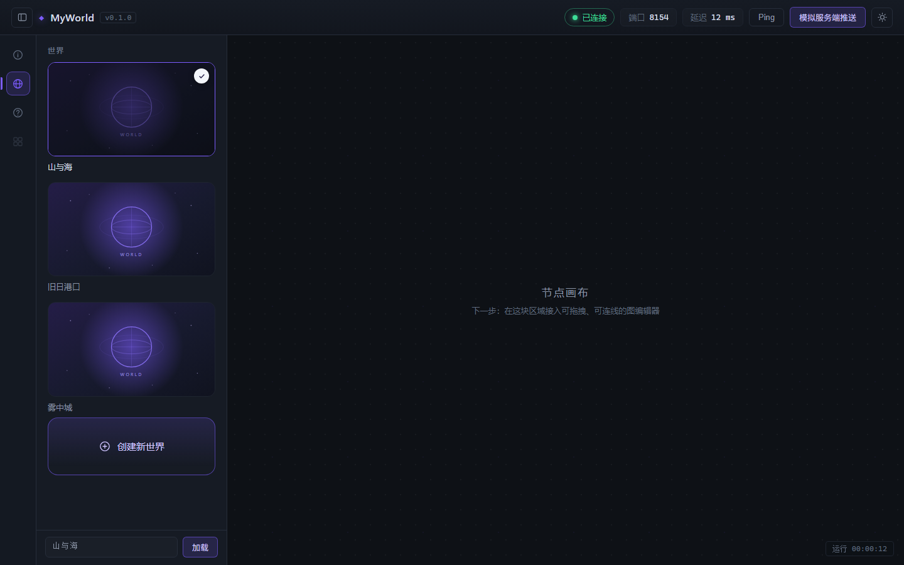

世界名的限制（目录名，所以卡得比较严）：最长 64 字符；不能含 `\ / : * ? " < > |`；不能以点开头；不能以空格或点结尾；不能用 Windows 保留名（`CON`、`COM1`、`LPT9` 之类）。前缀会去掉两端空格，重名返回 409。

数据目录默认是项目根下的 `data/`，可以改：

```powershell
.\MyWorld.exe --data-dir D:\worlds     # 或环境变量 MYWORLD_DATA_DIR
```

`data/` 里的内容不进版本库（只保留 `.gitkeep` 占位）。

## 预设与 presets/ 目录

预设是「可复用的属性表」，同样一个预设一个目录，放在世界目录旁边的 `presets/`（默认在项目根）：

```
presets/
  角色模板/
    preset.json     # 名字、创建时间、格式版本，以及一组属性名
```

**预设只记「有哪些属性」（键），不带值** —— 值永远存在角色自己身上，所以套用预设不会改动任何已有值：

```json
{
  "name": "角色模板",
  "format": 2,
  "created_at": "2026-11-25T13:05:17+00:00",
  "keys": ["年龄", "身份", "性格"]
}
```

在左侧功能区点「预设」，点底部的 **「创建新预设」**，在弹窗里填名字和若干「属性名」行即可（「＋ 添加属性名」可以继续加）。预设和世界共用一套名字规则（长度、非法字符、Windows 保留名等），重名返回 409。预设列表里每项会显示「N 个属性名」，鼠标悬停能看到具体属性名。

> 旧版预设文件里存的是 `attributes`（带值），读取时会自动只取属性名，不用手动迁移。

在预设行上**右键**可以删除该预设（目录连同 `preset.json` 一起删掉，确认后不可恢复）。

**点一下预设行**会打开「修改预设」弹窗：名字和属性名都已填好，改完点「保存」即可——改名字会同步重命名目录，属性名整组覆盖，重名返回 409。

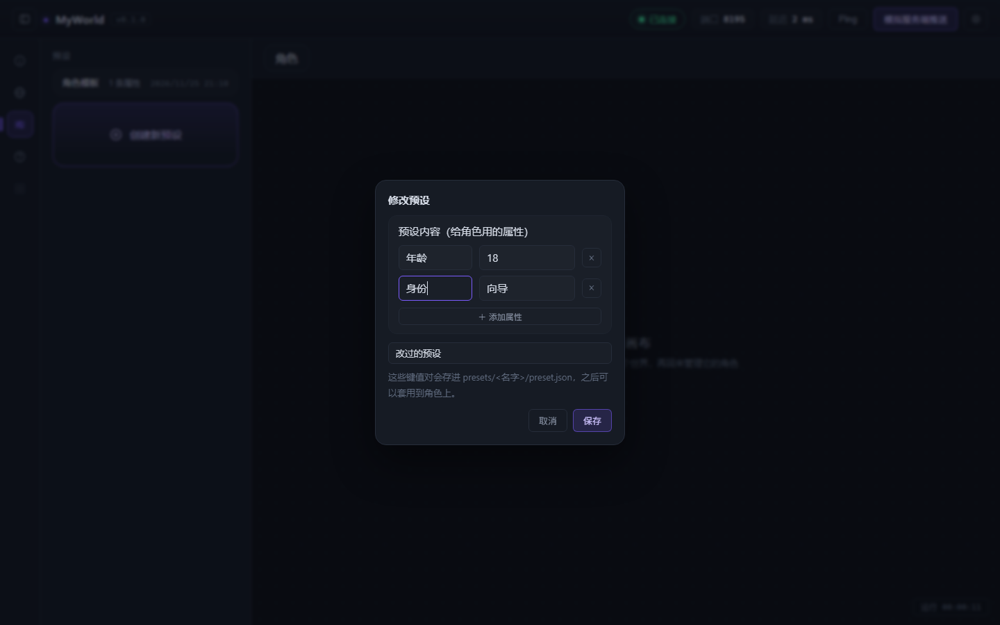

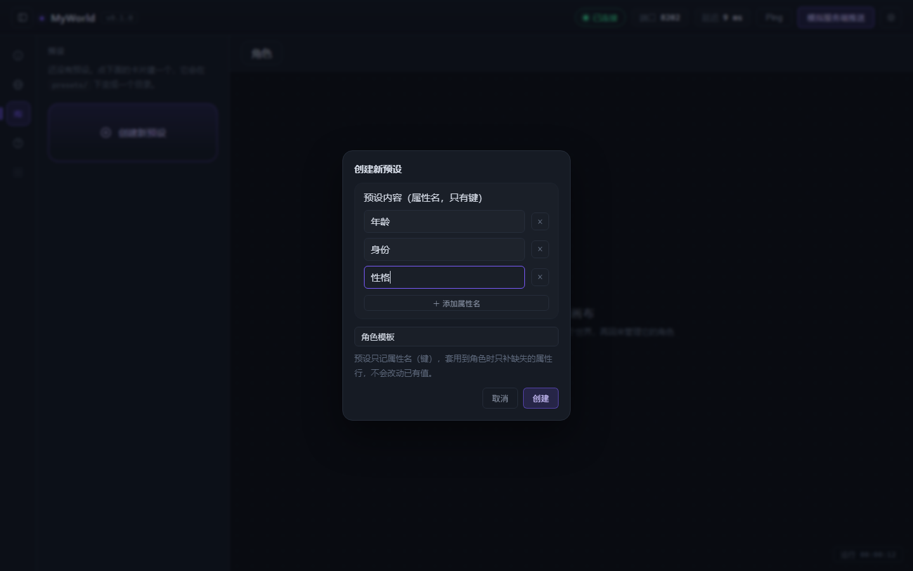

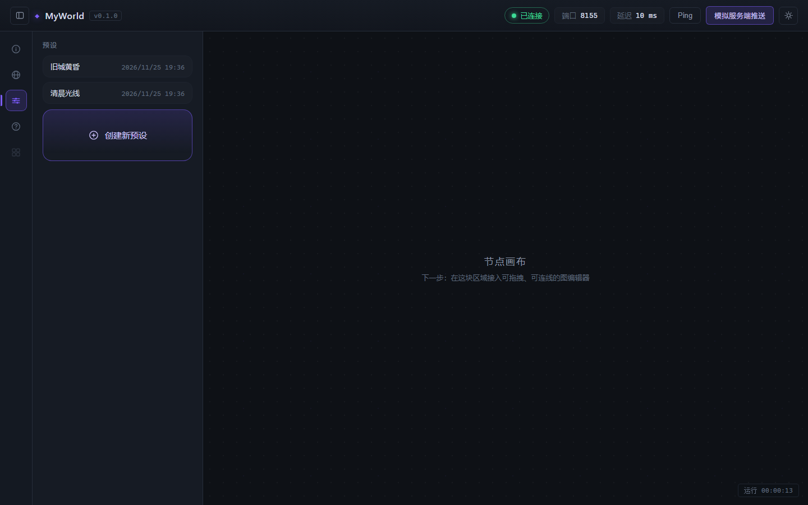

## 角色（画布区的「角色」栏）

先在「世界」里选中一个世界点「加载」，画布区就会切成该世界的角色图库：每个角色是一张 **9:16 立绘 + 下方名字**，按名字排序；最后那张虚线卡片是「新建角色」，点它在弹窗里输入名字即可。还没加载世界时，这一栏会提示先去左侧加载。

角色属于世界，存在世界目录下的 `role/` 里：

```
data/山与海/
  world.json
  role/
    阿澈/
      character.json
      portrait.png   # 可选，没有就用默认立绘
```

（早期版本用的是 `characters/`，程序读到旧目录会自动改名迁移成 `role/`，不会丢角色。）

默认立绘也有深浅两版，切主题自动换；想换自己的立绘用 `POST /api/worlds/{世界}/characters/{角色}/portrait`（PNG/JPEG/WebP，≤5 MB）。

新建角色时就能顺手导入立绘：点虚线框选一张本地图片，会弹出 **9:16 裁剪**窗口（拖动平移、**滚轮或滑杆缩放**、九宫格参考），确定后随角色一起上传。

在角色卡上**右键**有三个操作：「恢复默认」（删掉自定义立绘、回到占位图）、「移至最前」（排到第一位并落盘）和「删除」（连同立绘等文件，确认后不可恢复）；世界卡右键只有「删除」。

**点一下角色卡**，右侧滑入属性面板（宽度正好等于**两列卡片**，打开时其余卡片会平滑重排补位）：上面是 9:16 立绘，下面是一列可编辑的「属性名 + 值」行。

- **第一行固定是「姓名」**，它的值就是角色名 —— **不能与其他角色重复**（重名会被拦下）；改它等于给角色改名，会重命名目录并同步 `order.json`
- 其余属性行可以自由增删，**值是允许重复的，但属性名不能重复**——同一个角色里出现两个同名属性时，保存会被拦下并提示；旧数据里的重复项读取时只保留第一份（`character.json` 也会顺手整理干净）
- 改完点「保存」写回 `character.json`
- **点面板里的立绘可以换图**：选一张本地图片 → 9:16 裁剪 → 只做本地预览，点「保存」才真正上传；点「取消」或关掉面板就丢弃。上传后面板和卡片立绘同时更新（悬停立绘会显示「点击更换立绘」）
- 面板底部 **「导入预设」**：弹窗里列出现有预设（带属性名条数），选一个会让当前属性**对齐预设的清单**——缺的补上、不在清单里的属性**连同值一起删掉**。执行前会列出「补充 / 删除 / 保留」三组清单，**每一项都能单独勾选**（默认全勾），按钮显示「导入所选（N）」；删除只发生在界面上，不点「保存」就不会落盘

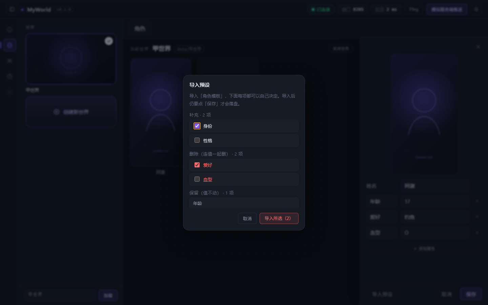

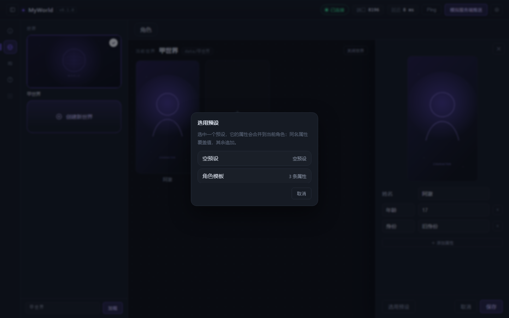
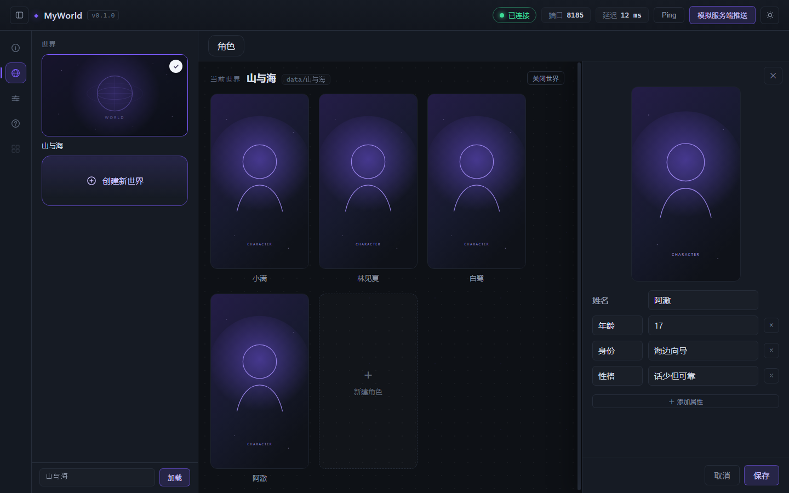

**拖动角色卡**可以调整显示顺序：顺序保存在 `role/order.json` 里，刷新或重开服务都保持；没记录过的角色按名字补在末尾。

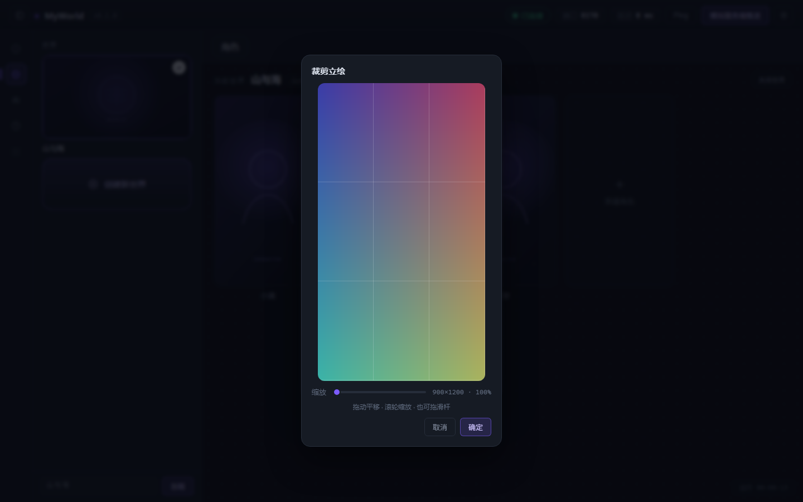

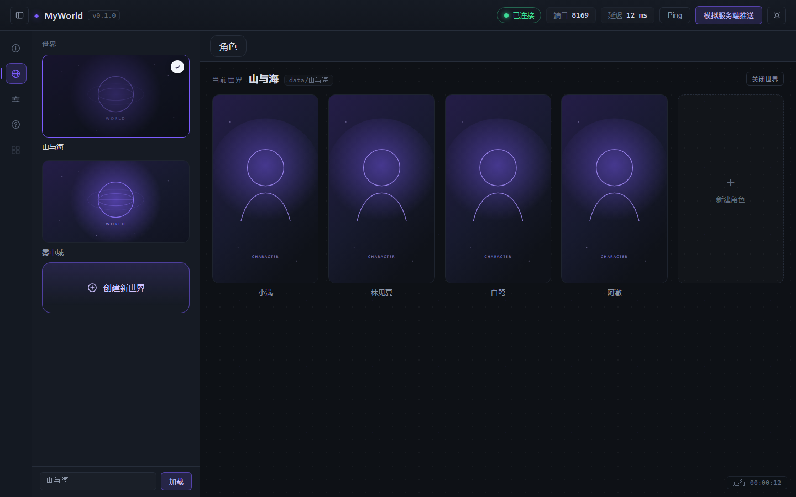

## 接口

| 方法 | 路径 | 说明 |
|---|---|---|
| GET | `/api/status` | 版本、端口、运行时长、PID、请求数、WS 连接数 |
| GET | `/api/config` | 生效配置 + **每个字段的来源**（cli / env / file / default） |
| GET | `/api/events` | 事件总线订阅者数量 |
| GET | `/api/worlds` | 列出 `data/` 下所有世界 |
| POST | `/api/worlds` | 创建世界，体 `{"name": "名字"}`；重名 409、非法名 400 |
| DELETE | `/api/worlds/{名字}` | 删除世界（连同目录内容）；不存在 404 |
| GET | `/api/worlds/{名字}/thumbnail` | 世界缩略图；没有真实图片时按 `?theme=dark\|light` 返回对应默认图，世界不存在 404 |
| POST | `/api/worlds/{名字}/thumbnail` | 上传封面（裁剪后的原图字节，PNG/JPEG/WebP，≤5 MB）；非图片 400、太大 413 |
| GET | `/api/presets` | 列出 `presets/` 下所有预设 |
| POST | `/api/presets` | 创建预设，体 `{"name": "名字", "keys": ["属性名", ...]}`；重名 409、非法名 400 |
| PATCH | `/api/presets/{预设}` | 修改预设，体 `{"name"?: "...", "keys"?: [...]}`；改名冲突 409 |
| DELETE | `/api/presets/{预设}` | 删除预设目录；不存在 404 |
| GET | `/api/worlds/{世界}/characters` | 列出某个世界的角色 |
| POST | `/api/worlds/{世界}/characters` | 新建角色，体 `{"name": "名字"}`；重名 409 |
| DELETE | `/api/worlds/{世界}/characters/{角色}` | 删除角色（连同立绘）；不存在 404 |
| DELETE | `/api/worlds/{世界}/characters/{角色}/portrait` | 删除自定义立绘、恢复默认占位图；幂等 |
| PUT | `/api/worlds/{世界}/characters/order` | 保存角色顺序，体 `{"names": [...]}`；未列出的按名字补末尾 |
| GET | `/api/worlds/{世界}/characters/{角色}` | 角色详情（含 `attributes`） |
| PATCH | `/api/worlds/{世界}/characters/{角色}` | 改姓名 / 属性，体 `{"name"?, "attributes"?}`；改名冲突 409 |
| GET | `/api/worlds/{世界}/characters/{角色}/portrait` | 角色立绘；没有则按 `?theme=` 返回默认图 |
| POST | `/api/worlds/{世界}/characters/{角色}/portrait` | 上传立绘（PNG/JPEG/WebP，≤5 MB） |
| POST | `/api/demo/tick` | 向所有已连接页面广播一条事件（验证推送链路） |
| GET | `/api/docs` | 自动生成的 Swagger 文档 |
| WS | `/ws` | 心跳与事件推送通道 |

WebSocket 协议（全部是 JSON）：

```jsonc
// 服务端 → 客户端，连接建立时
{ "kind": "hello", "version": "0.1.0", "port": 8000, "pid": 1234, "uptime_seconds": 1.2 }

// 客户端 → 服务端，心跳
{ "type": "ping", "t": 1712345678901 }
// 回应
{ "kind": "pong", "t": 1712345678901, "server_time": 1712345678.9 }

// 客户端 → 服务端，让所有页面收到一条广播
{ "type": "broadcast", "payload": { "hello": "world" } }

// 客户端 → 服务端，拉一次完整状态
{ "type": "stats" }
```

## 目录结构

```
MyWorld.exe            原生启动器（gcc 编译，已随仓库提供）
tools/
  launcher.c           启动器源码：找 Python、透传参数、UTF-8、退出码
myworld/
  __init__.py          版本号
  __main__.py          命令行入口（参数解析、banner、启动 uvicorn）
  config.py            配置解析：优先级合并、端口校验与自动顺延
  events.py            进程内事件总线（发布 → 多个 WS 订阅者）
  server.py            FastAPI 应用：REST + WebSocket + 静态托管
  worlds.py            世界管理：名字校验、创建、列表（data/ 目录）
  characters.py        角色管理：每个世界下的 role/ 子目录
  presets.py           预设管理：同样的名字规则，存 presets/ 目录
web/
  index.html           界面结构：顶栏 / 左侧功能区 / 内容面板 / 二级顶栏 / 画布
  css/style.css        明暗两套主题 + 排版刻度（全部是 CSS 变量）
  js/app.js            状态渲染、WS 连接/心跳/重连、世界图库与创建
  img/world-default.svg 世界缩略图默认图（深色）
  img/world-default-light.svg 世界缩略图默认图（浅色）
  img/character-default.svg 角色立绘默认图（深色）
  img/character-default-light.svg 角色立绘默认图（浅色）
data/
  .gitkeep             世界目录（内容不入库）
presets/
  .gitkeep             预设目录（内容不入库）
tests/
  test_config.py       配置解析单元测试（纯标准库）
  test_worlds.py       世界名字校验与增删单元测试
  test_characters.py   角色创建、立绘、目录归属单元测试
  test_presets.py      预设创建与目录隔离单元测试
  smoke_test.py        端到端冒烟测试（真实进程 + REST + WS + 世界/角色/预设 API）
myworld.config.example.json
```

## 测试

```powershell
python tests/test_config.py     # 配置与端口逻辑：11 项
python tests/test_worlds.py     # 世界名字校验、创建列表、缩略图、删除：18 项
python tests/test_characters.py # 角色创建、重名、立绘、删除、顺序、改名、属性去重：20 项
python tests/test_presets.py    # 预设创建、属性名、旧格式兼容、修改改名、删除：16 项
python tests/smoke_test.py      # 起真实服务，跑 HTTP + WebSocket + 世界/角色/预设 API：71 项
```

## 下一步

- [ ] 节点画布：可拖拽、可连线的图编辑器（LiteGraph 或自研 canvas）
- [ ] 节点定义与后端执行队列（提交任务 → WS 推送进度）
- [ ] 原生计算模块 `native/`：图像/音频算子用 C/C++ 实现，Python 侧调用
- [ ] 任务历史与结果预览
