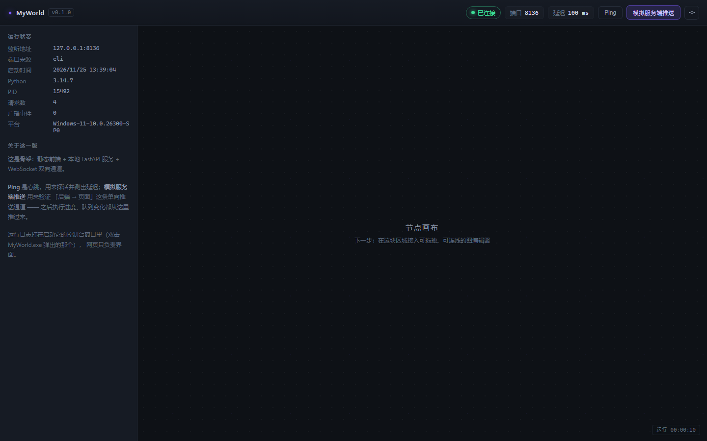

# MyWorld

本地跑一个服务，浏览器打开就是一个工作台 —— 类似 ComfyUI 的那种形态：**前端只负责界面与交互，后端负责内容与任务**，两者通过 REST + WebSocket 通信。

当前是 **v0.1.0 骨架版**：端口管理、静态前端、REST 状态接口、WebSocket 心跳/重连/服务端广播链路都已打通，明暗两套主题可切换，节点画布留在下一步。

深色：



浅色（右上角 ☀/☾ 切换，或访问 `?theme=light`）：


## 快速开始

双击 `MyWorld.exe`，或在命令行里：

```powershell
.\MyWorld.exe                     # 默认 http://127.0.0.1:8000，并自动打开浏览器
.\MyWorld.exe --port 9000         # 换端口
.\MyWorld.exe --no-open           # 只要服务，不弹浏览器
.\MyWorld.exe --print-args        # 只打印最终命令行，排查参数问题
```

双击运行时，服务起来后浏览器会自动跳到工作台；从脚本调用或被重定向（`> log.txt`）时不会自动弹窗口，避免干扰自动化。

首次使用前装依赖（本机已就绪，换机器才需要）：

```powershell
python -m pip install -r requirements.txt
```

## 运行入口是一个原生 exe

`MyWorld.exe` 由 [`tools/launcher.c`](tools/launcher.c) 用 gcc 静态编译，不依赖 PowerShell，也不依赖任何 mingw 运行时 DLL（只用到 Windows 自带的 KERNEL32 与 UCRT）。

它在启动 Python 之前做了这几件事：

| 行为 | 说明 |
|---|---|
| 切工作目录 | 以 exe 所在目录为工作目录，因此可以双击、也可以从任意路径调用 |
| 找解释器 | `MYWORLD_PYTHON` 环境变量 → `.venv\Scripts\python.exe` → PATH 上的 `python` / `python3` / `py -3` |
| 校验项目根 | exe 旁边没有 `myworld\` 时直接给出可读提示，而不是抛一堆 Python 报错 |
| 强制 UTF-8 | 设置 `PYTHONUTF8=1`、`PYTHONIOENCODING=utf-8`，控制台与重定向文件都不会乱码 |
| 透传参数与退出码 | `--port` 等参数原样转发；Python 返回几，exe 就返回几（实测非法端口返回 2） |
| 自动开浏览器 | 挂在交互式控制台上（双击或终端里直接跑）时，服务启动即打开工作台；`--no-open` 可关，重定向场景不会打扰 |
| 日志去向 | 服务端事件、uvicorn 启动信息统一打在这个控制台窗口；网页端只做界面，不放日志面板 |
| Ctrl+C 处理 | 启动器自己忽略 Ctrl+C，交给 uvicorn 优雅关闭，避免留下孤儿进程 |

改了 `launcher.c` 之后重新构建：

```powershell
gcc -O2 -municode -static -static-libgcc -o MyWorld.exe tools\launcher.c
```

> 目前只支持 Windows。C/C++ 的用武之地不止启动器：后续节点执行里的图像处理、音频解码这类计算密集的算子，会以原生模块的形式加进 `native/`，Python 通过扩展模块或进程调用。

## 端口与配置

优先级从高到低：**命令行参数 → 环境变量 `MYWORLD_*` → 配置文件 `myworld.config.json` → 内置默认值**。

| 方式 | 写法 | 说明 |
|---|---|---|
| 命令行 | `.\MyWorld.exe --port 9000` | 最直接 |
| 环境变量 | `$env:MYWORLD_PORT = 9000` | 适合脚本/IDE 里固定 |
| 配置文件 | 复制 `myworld.config.example.json` 为 `myworld.config.json` | 适合长期项目配置 |

字段：`host`（默认 `127.0.0.1`，只允许本机访问）、`port`（默认 `8000`）、`open_browser`、`log_level`。

端口行为：

- 端口被占用时**自动向上找一个空闲端口**，启动 banner 会写明「8000 被占用，已顺延到 8001」，前端「运行状态」里也显示「端口来源」。
- 加 `--strict-port` 则改为直接报错退出，适合需要固定端口的场景。
- 想让局域网其他设备访问，用 `--host 0.0.0.0`（注意：无鉴权，仅限可信网络）。

## 明暗主题

右上角的 ☀/☾ 按钮切换明暗，选择记在 `localStorage`；首次访问跟随系统的 `prefers-color-scheme`，系统主题变了也会跟着变（除非你手动选过）。

- 强制某个主题：`http://127.0.0.1:8000/?theme=light`（截图、演示时方便）
- 两套配色全部收敛在 [`web/css/style.css`](web/css/style.css) 的 CSS 变量里：`:root` 是深色，`:root[data-theme="light"]` 覆盖成浅色。加新组件时用变量，就不会在浅色下出现白底白字。

## 接口

| 方法 | 路径 | 说明 |
|---|---|---|
| GET | `/api/status` | 版本、端口、运行时长、PID、请求数、WS 连接数 |
| GET | `/api/config` | 生效配置 + **每个字段的来源**（cli / env / file / default） |
| GET | `/api/events` | 事件总线订阅者数量 |
| POST | `/api/demo/tick` | 向所有已连接页面广播一条事件（验证推送链路） |
| GET | `/api/docs` | 自动生成的 Swagger 文档 |
| WS | `/ws` | 心跳与事件推送通道 |

WebSocket 协议（全部是 JSON）：

```jsonc
// 服务端 → 客户端，连接建立时
{ "kind": "hello", "version": "0.1.0", "port": 8000, "pid": 1234, "uptime_seconds": 1.2 }

// 客户端 → 服务端，心跳
{ "type": "ping", "t": 1712345678901 }
// 回应
{ "kind": "pong", "t": 1712345678901, "server_time": 1712345678.9 }

// 客户端 → 服务端，让所有页面收到一条广播
{ "type": "broadcast", "payload": { "hello": "world" } }

// 客户端 → 服务端，拉一次完整状态
{ "type": "stats" }
```

## 目录结构

```
MyWorld.exe            原生启动器（gcc 编译，已随仓库提供）
tools/
  launcher.c           启动器源码：找 Python、透传参数、UTF-8、退出码
myworld/
  __init__.py          版本号
  __main__.py          命令行入口（参数解析、banner、启动 uvicorn）
  config.py            配置解析：优先级合并、端口校验与自动顺延
  events.py            进程内事件总线（发布 → 多个 WS 订阅者）
  server.py            FastAPI 应用：REST + WebSocket + 静态托管
web/
  index.html           界面结构
  css/style.css        明暗两套主题（CSS 变量）
  js/app.js            状态渲染、WS 连接/心跳/重连（日志在控制台，页面不放日志）
tests/
  test_config.py       配置解析单元测试（纯标准库）
  smoke_test.py        端到端冒烟测试（真实进程 + REST + WS）
myworld.config.example.json
```

## 测试

```powershell
python tests/test_config.py     # 配置与端口逻辑：9 项
python tests/smoke_test.py      # 起真实服务，跑 HTTP + WebSocket 全链路：10 项
```

## 下一步

- [ ] 节点画布：可拖拽、可连线的图编辑器（LiteGraph 或自研 canvas）
- [ ] 节点定义与后端执行队列（提交任务 → WS 推送进度）
- [ ] 原生计算模块 `native/`：图像/音频算子用 C/C++ 实现，Python 侧调用
- [ ] 任务历史与结果预览
